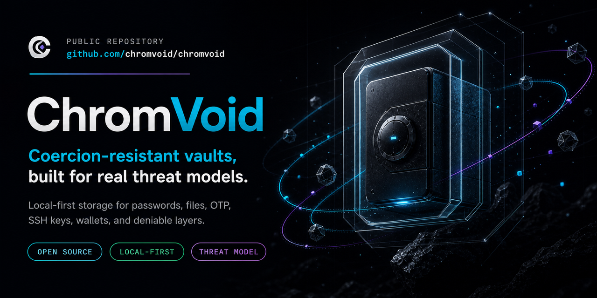

# ChromVoid

Local-first encrypted vault for passwords, OTP, notes, files, and related secret workflows.

[](https://github.com/chromvoid/chromvoid/releases/latest)
[](https://github.com/chromvoid/chromvoid/releases/latest/download/chromvoid-android-universal.apk)
[](SECURITY.md)
[](LICENSING.md)

[Download Android](https://github.com/chromvoid/chromvoid/releases/latest/download/chromvoid-android-universal.apk) ·
[Latest release](https://github.com/chromvoid/chromvoid/releases/latest) ·
[Threat Model](https://chromvoid.com/en/threat-model/) ·
[Security Policy](SECURITY.md) ·
[Website](https://chromvoid.com/en/)



ChromVoid is built for people who want control over where their secrets live: on a local device, or on a phone that acts as the source of truth. It does not make a cloud account the source of truth for your vault.

## Why ChromVoid

- **Local-first vault** - secrets stay with you, locally or on your phone-held host.
- **Thin browser integration** - the browser extension is not a second vault.
- **Autofill without cloud storage** - supported autofill paths depend on local vault state, not a background cloud password database.
- **Deniability-oriented design** - decoy and hidden vaults are threat-model-bound, not magic.
- **Open security posture** - the threat model, security policy, and repository are public.

## Try the Android build

- Download the current APK: [chromvoid-android-universal.apk](https://github.com/chromvoid/chromvoid/releases/latest/download/chromvoid-android-universal.apk).
- Release notes and checksums live with the [latest GitHub release](https://github.com/chromvoid/chromvoid/releases/latest).
- Review the [Threat Model](https://chromvoid.com/en/threat-model/) before relying on deniability-oriented behavior.

## What ChromVoid helps with

- **Passwords and OTP** - store login records, passwords, one-time password profiles, and private notes in an encrypted vault.
- **Notes and files** - keep sensitive documents and folder-based work inside the vault. Mounted Vault supports workflows where an unlocked vault appears as a normal desktop folder.
- **Local and mobile-host modes** - use a vault locally on desktop or mobile, or let a phone hold the secrets while desktop connects as a thin client.
- **Autofill without a browser vault** - use the browser extension or supported Credential Provider integrations without storing secrets in the browser profile.
- **Imports** - bring data in from common password managers such as 1Password, Bitwarden, and Chrome.
- **Emergency Access** - configure delayed, controlled release for a trusted recipient. This is not instant password recovery.
- **Deniability-oriented design** - use decoy and hidden vaults for coercion-aware workflows. The limits depend on the threat model, storage medium, and operational habits.

## Security posture

ChromVoid is a security tool, not legal advice or a replacement for operational security.

The product is designed around a few practical boundaries:

- secrets stay with you, locally or on your phone;
- the browser extension is a thin shell and does not become a second vault;
- supported autofill paths require local vault state instead of background cloud access;
- a locked vault should fail closed rather than unlock silently in the background;
- deniability is conditional and should be evaluated against a concrete threat model.

If a device is compromised while the vault is open, the live session becomes the sensitive boundary. ChromVoid reduces exposure paths, but it cannot make an actively observed open session safe.

## Repository

This monorepo contains the ChromVoid application code, shared packages, and supporting services.

```text
chromvoid/
├── apps/                 # Desktop app, WebView UI, browser extension, relay
├── backend/              # Backend services, landing pages, blog, admin
├── crates/               # Rust core, protocol, FUSE, CLI, platform bridges
├── packages/             # Shared TypeScript packages and UI libraries
└── tests/                # Integration and E2E tests
```

The codebase is organized around a Rust core, a shared WebView application UI, browser and platform integrations, and reusable TypeScript packages. Technical details live in the relevant package, crate, and feature documentation rather than in this README.

## Feedback and contributions

- Bug reports and feature requests should use the GitHub issue templates.
- Security vulnerabilities should be reported privately through [SECURITY.md](SECURITY.md).
- Contribution expectations are documented in [CONTRIBUTING.md](CONTRIBUTING.md).
- Community conduct expectations are documented in [CODE_OF_CONDUCT.md](CODE_OF_CONDUCT.md).

## License

ChromVoid uses a mixed `AGPL-3.0-only + Commercial` licensing model, with some standalone reusable packages under permissive licenses.

See [LICENSING.md](LICENSING.md) for the authoritative path-level license matrix. Package-level license fields remain authoritative where they are present.

## Infrastructure

Production infrastructure and deployment are maintained in a separate, private repository.
